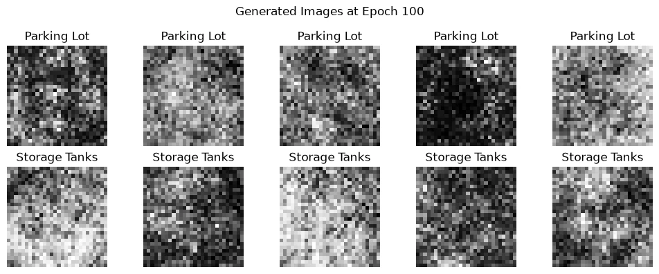
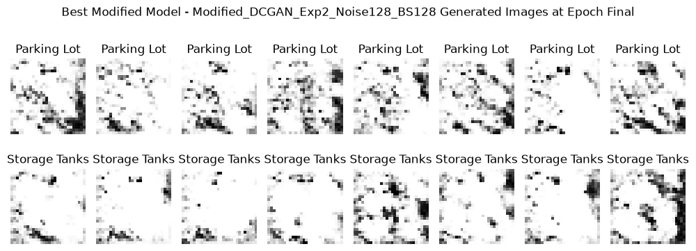
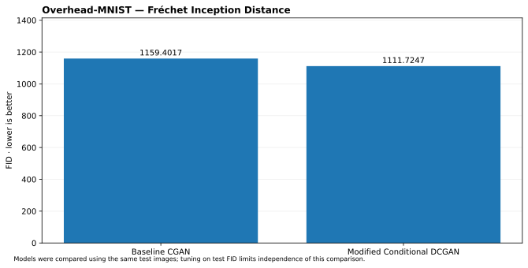

# Overhead-MNIST Image Generation — Conditional GAN and Conditional DCGAN

**Individual academic Deep Learning project | Image generation | TensorFlow / Keras**

## Problem and dataset

Train a label-conditioned generator to create 28 × 28 grayscale overhead images representing **Parking Lot** and **Storage Tanks**. Because both generator and discriminator use class labels, the baseline is a **Conditional GAN (CGAN)** rather than an unconditional GAN.

The original IDX data were filtered into **14,232 training images** (7,111 Parking Lot, 7,121 Storage Tanks) and **1,784 held-out real images** (896 Parking Lot, 888 Storage Tanks). Images were scaled from 0–255 to **[-1, 1]** to match the generator's `tanh` output; class labels were remapped to 0 and 1.

## Modeling and experimentation

**Baseline CGAN** uses a 100-dimensional noise vector, label embeddings, and dense generator/discriminator architectures. A custom adversarial training loop alternately updates the discriminator on real/fake images and updates the generator through a temporarily frozen discriminator. Baseline setup: 100 epochs, batch size 128, Adam with `beta_1=0.5`, and learning rates 0.00005 for both networks.

**Modified Conditional DCGAN** introduces spatial convolutions and Conv2DTranspose, dropout and adjusted optimization parameters. Three modified hyperparameter configurations were explored. The best observed experiment used 128-dimensional noise, batch size 128, 150 epochs, 100 steps per epoch, generator LR 0.0002, discriminator LR 0.0001, dropout 0.3, and real-label smoothing 0.9.

## Recorded FID results (lower is better)

| Generator | FID |
| --- | ---: |
| Dense baseline Conditional GAN | **1,159.4017** |
| Modified Conditional DCGAN — experiment 1 | 1,141.6341 |
| Modified Conditional DCGAN — experiment 2 | **1,111.7247** |
| Modified Conditional DCGAN — experiment 3 | 1,114.7536 |

The best observed modified FID is approximately **4.11% lower** than baseline. However, **all absolute FID values remain high**, and visual samples are only partially structured. This does **not** demonstrate realistic overhead-image generation. The ImageNet InceptionV3 feature space is also not a perfect fit for upsampled grayscale aerial imagery.

**Evaluation caveat:** the three modified variants were compared against FID computed using the same real **test reference images**, meaning the chosen winner is **test-reference selected**. It is **not an independent final unseen-test estimate**, and must not be represented as such. Additionally, FID does not by itself verify class-conditional correctness or diversity.

## Original generated-image grids

| Baseline CGAN | Modified Conditional DCGAN |
| --- | --- |
|  |  |

## Repository contents and provenance

- [`notebooks/overhead_mnist_conditional_gan.ipynb`](notebooks/overhead_mnist_conditional_gan.ipynb): **notebook reconstructed from the user-provided Jupyter HTML export**, preserving source Python cells but omitting execution outputs.
- [`reports/original_notebook_export.html`](reports/original_notebook_export.html): original HTML export with saved figures and outputs.
- [`reports/conditional_gan_report.pdf`](reports/conditional_gan_report.pdf): project report as originally supplied.
- [`figures/`](figures/): historical generation samples and result comparisons.

The original native `.ipynb` was not supplied. This repository provides reconstructed source for readability but **does not claim to contain the exact original `.ipynb`**, nor were the training runs reproduced in this packaging step.

## Reproduction

Acquire the authorized Overhead-MNIST IDX dataset separately and place image/label files in `data_soal_2/` relative to the repository root. Use Python and `requirements.txt`, run notebook cells in order and expect compute-intensive GAN training. Dataset files, generator weights, and discriminator weights are not included.

[View portfolio case study](https://hazel-portfolio-rose.vercel.app/projects/overhead-mnist-cgan)
